<a href="https://moumen-alkamsheh.vercel.app/work/magic-show">
  
</a>

<h1 align="center">Magic Show — Backend API</h1>

<p align="center">The domain, not the decoration — products, orders, carts, and the rules that hold them together.</p>

<p align="center">
  <a href="docs/api/API_DOCUMENTATION.md"></a>
  <a href="https://moumen-alkamsheh.vercel.app/work/magic-show"></a>
  <a href="https://github.com/mouminkam"></a>
</p>


| Magic Show | Repository | Stack | Live |
| --- | --- | --- | --- |
| Storefront | [`Magic_Show`](https://github.com/mouminkam/Magic_Show) | Next.js 16 · TypeScript | [magic-show.vercel.app](https://magic-show.vercel.app) |
| Admin console | [`Magic-Show-dashboard`](https://github.com/mouminkam/Magic-Show-dashboard) | React 19 · Vite · TanStack | [magic-show-dashboard.vercel.app](https://magic-show-dashboard.vercel.app) |
| **Backend API** · this repo | [`Magic-Show-back-end-`](https://github.com/mouminkam/Magic-Show-back-end-) | Laravel 12 · Sanctum | — |

## Overview

An **API-only Laravel 12 service** for the Magic Show (Magic Shoe) e-commerce platform. It owns the domain —
products, categories, orders, carts, wishlists, blog, page content, inventory — and exposes it as a versioned JSON
REST API under `/api/v1`. It renders no HTML: no Blade admin, no session login, no asset build.

That is deliberate. The service used to ship a Blade admin panel; it was removed in full (32 controllers, 162 views,
the whole asset pipeline) once the standalone React console took over. What is left does one thing: serve data
correctly, safely and quickly. The two front ends run on mock data today, so each piece can be evaluated alone.

## Highlights

| Area | Endpoints |
| --- | --- |
| Health | `GET /api/v1/health` (Laravel's own probe stays at `/up`) |
| Auth | `POST /api/v1/auth/*` — register, login, logout, profile, password reset |
| Content | `GET /api/v1/home/*`, `/about/*`, `/shop/*`, `/blog/*`, `/stores`, `/contact/*` |
| Catalog | `GET /api/v1/products`, `/categories`, `/reviews` |
| Cart and checkout | `/api/v1/cart/*` — guests and signed-in customers |
| Orders, wishlist | `/api/v1/orders/*`, `/api/v1/wishlist/*` (auth required) |
| Public forms | `/api/v1/newsletter/*`, `/api/v1/contact/send-message` — rate-limited |
| Staff | `/api/v1/admin/orders/*` — a staff token with an admin role |

The full reference is in [`docs/api/API_DOCUMENTATION.md`](docs/api/API_DOCUMENTATION.md), with Postman collections in
[`docs/postman/`](docs/postman).

## Architecture

```text
app/
├── Http/Controllers/Api/   One controller per area, all under /api/v1
├── Http/Middleware/        EnsureAdminApi (staff roles), set.language (request locale)
├── Models/                 Customer (shoppers) and User (staff) as separate authenticatables, plus the domain
├── Services/               Firebase notifications and the domain services behind the controllers
└── Providers/              Rate limiters: api, auth, contact, newsletter, comments
routes/api.php              The whole API surface; routes/web.php only describes the service at /
database/                   Migrations and seeders
tests/                      Feature tests (auth, checkout, newsletter, security regressions) and unit tests
docs/                       API reference, auth guide, Postman collections
```

**Request flow:** `routes/api.php` → throttle and `auth:sanctum` (+ `admin.api` for staff) → controller → models
and services → JSON envelope.

## Getting started

```bash
composer install
cp .env.example .env          # Windows: copy .env.example .env
php artisan key:generate
php artisan migrate --seed
php artisan storage:link
php artisan serve
```

Set `DB_*`, `APP_URL` and `FRONTEND_URL` in `.env`. `FRONTEND_URL` drives CORS, the Sanctum stateful domains and the
links in password-reset emails. Requirements: PHP 8.2+, Composer 2, MySQL/MariaDB or SQLite.

## Scripts

| Command | What it does |
| --- | --- |
| `php artisan serve` | Development server |
| `php artisan test` | PHPUnit feature and unit tests (SQLite in memory) |
| `composer audit` | Security advisories for every dependency |

CI runs `composer audit` and the test suite on every push and pull request.

## Engineering notes

### Two kinds of account, on purpose

**`Customer`** is a storefront shopper: it registers through `/api/v1/auth/*` and gets a Sanctum personal access token.
**`User`** is staff, with a role (`super_admin`, `store_manager`, `product_manager`, `analytics_team`,
`customer_service`) and permissions; staff routes stack `auth:sanctum` with `admin.api`, which requires a
`super_admin` or `store_manager` token. Two models instead of one with a role flag keeps a shopper's token from ever
reaching a staff route.

A password reset **revokes every existing token** for that customer, and `forgot-password` **always answers 200**, so
it can't be used to find out who has an account. Ownership checks on carts, orders and wishlists, row locks on stock
decrement and coupon redemption, and bounded cache keys on public search are all covered by
`tests/Feature/SecurityRegressionTest.php`.

### Upgrade, don't suppress

Every `laravel/framework` 11.x release carries open advisories, and Composer refuses a flagged install by default.
The fix was to upgrade the framework rather than silence the warning, and there is still no `config.audit.ignore`
entry. CI runs `composer audit` on every push: its first run caught advisories published in 2026 for
`laravel/framework`, Symfony, CommonMark and Flysystem, and a `composer update` within the existing constraints
(Laravel 12.73, Symfony 7.4.23) cleared every one of them — 68 tests, 134 assertions, all green.

## Honest trade-offs

- Neither front end calls this API yet; both run on mock data so each piece stands alone. Wiring them is a
  contained next step.
- Firebase credentials are never committed. Without `FIREBASE_CREDENTIALS` or `FIREBASE_CREDENTIALS_JSON`, new-order
  push notifications are skipped silently — see [`FIREBASE_SETUP.md`](FIREBASE_SETUP.md).
- `composer.json` still carries the skeleton's package name (`laravel/laravel`).

<a href="https://github.com/mouminkam">
  
</a>
